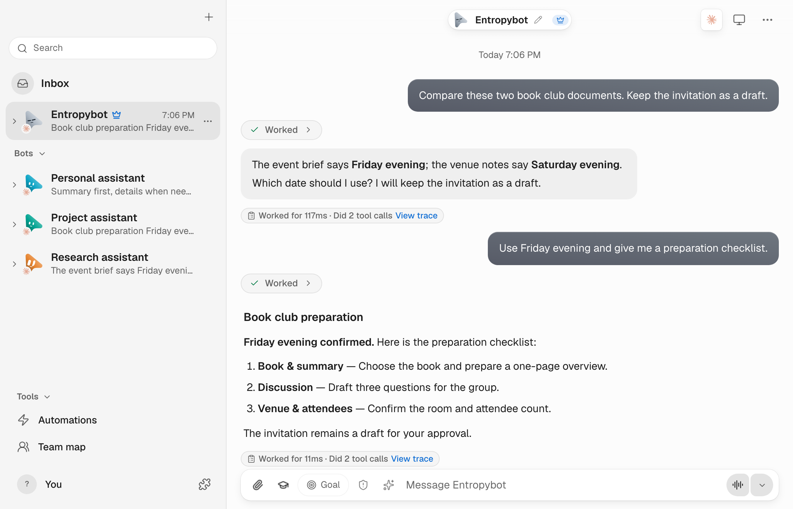

# Entropybot

Keep your information, memories and tasks in one desktop workspace. A local-first AI assistant for macOS, with the models and execution engines you choose.

[Try it online](https://bot.cloudentropy.ai/?lang=en) · [Download for macOS](https://github.com/Ashersun1207/entropybot/releases/latest) · [中文](README.md)

<a href="https://bot.cloudentropy.ai/?lang=en">
<picture>
  <source media="(prefers-color-scheme: dark)" srcset="docs/images/readme-workspace-dark-en.png" />
  
</picture>
</a>

*Captured from the current development build using synthetic data and preset replies; the public download may differ. Click the image to try the website workspace. See the [release notes](https://github.com/Ashersun1207/entropybot/releases) for features available in the public download.*

## What you can do

| Use case | How it works |
| --- | --- |
| Organize information | Compare documents, summarize findings, and keep differences, sources and open questions together. |
| Move tasks forward | Explain the goal, timing and boundaries. Ask for steps and results, and confirm decisions when needed. |
| Keep context | Give assistants distinct roles, continue existing conversations, and view or revise their memories. |
| Choose your models | Connect model services and execution engines for your tasks, within your own desktop workspace. |

Tool use and task execution depend on the connected model, engine and permissions you grant.

## Get started

1. Download the macOS Apple silicon version from [Releases](https://github.com/Ashersun1207/entropybot/releases/latest).
2. Install it, connect your chosen model service or execution engine, and configure its credentials.
3. Create or select an assistant and give it a clear task. Start with a document comparison, summary or preparation checklist.

You can also [try the website](https://bot.cloudentropy.ai/?lang=en): switch assistants, type and send messages. Chinese / EN examples use synthetic data and preset replies isolated in your tab. No live model, account or personal memory is connected.

## Releases and data

- The current public download is **0.2.3**. **0.2.6 remains an unpublished candidate.** Source UI may be ahead of the downloadable version.
- The current target is **macOS on Apple silicon**. Public builds use ad-hoc signing and are not notarized by Apple. Read the release notes before installing.
- Memories and indexes stay on your machine. Remote models and cloud embeddings send relevant content to the services you configure and may incur charges.
- Quit the app and back up your workspace and desktop configuration before updating. Personal chats, real memories and credentials are not included in the public repository.

[Installation, backup and updates](docs/ENTROPYBOT_UPDATES.md) · [All releases](https://github.com/Ashersun1207/entropybot/releases)

## Development

Requires Node.js 24+ and pnpm 10.33.0:

```sh
pnpm install --frozen-lockfile
```

Start the server and frontend in separate terminals:

```sh
pnpm dev:server
```

```sh
pnpm dev
```

Configure model credentials locally; do not commit them. Use isolated fixtures and synthetic data for verification; see [verification guidance](docs/verification/README.md). The application bundle ID is `ai.entropybot.desktop`; versions and update channels are managed independently.

[Website build and preview](site/README.md) · [Website experience requirements](site/EXPERIENCE.md)

## Origin and license

Entropybot is an independent fork developed by Ashersun1207 from [OpenMausBot](https://github.com/milind-soni/OpenMausBot), with no affiliation to the upstream maintainers. Original attribution, the [Apache-2.0 LICENSE](LICENSE) and [NOTICE](NOTICE) are retained.

`enterprise/` has a [separate license](enterprise/LICENSE) and is outside the Apache-2.0 grant. Upstream names and artwork remain subject to their owners' trademark rights; this project does not grant those rights or an enterprise production-use license.
