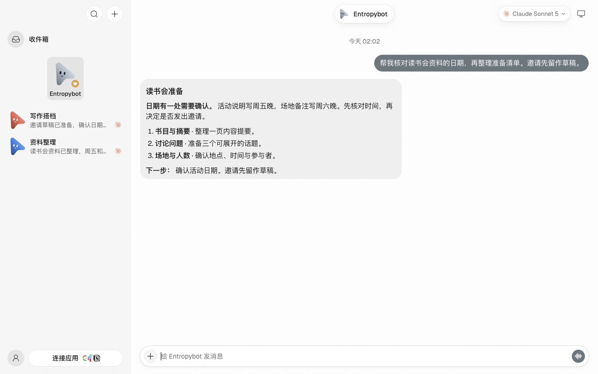

# Entropybot

A local-first team of AI assistants for macOS. Chat with assistants focused on different roles, connect the models and execution engines you choose, and manage their memories and tasks on your desktop.

[Website · Try it online](https://bot.cloudentropy.ai/?lang=en) · [中文](README.md) · [Download for macOS](https://github.com/Ashersun1207/entropybot/releases/latest) · [Releases](https://github.com/Ashersun1207/entropybot/releases) · [Updates and migration](docs/ENTROPYBOT_UPDATES.md)



## Start with a conversation

- **Assistant roles:** choose assistants in the sidebar and select models and execution engines for their tasks.
- **Local memory:** memories and indexes stay on your machine, with Chinese search and optional DashScope `text-embedding-v4` semantic retrieval.
- **Long conversations:** budget-aware history replay and context compression, including handling for context-length errors, content arrays and repeated tool-call IDs.
- **Independent updates:** Entropybot has its own identity, versions and GitHub Releases. Updates are currently checked and installed manually.

Local storage does not mean all processing is offline. Remote models and cloud embeddings send relevant content to the services you configure and may incur charges. Credentials, personal chats and real memories are not included in this repository.

## Download and release status

Download only the public versions and attachments listed in [this repository's Releases](https://github.com/Ashersun1207/entropybot/releases). The current public release is **0.2.3**. **0.2.6 remains an unpublished local candidate.**

The current target is macOS on Apple silicon. Existing builds use ad-hoc signing and are not notarized by Apple; stable Developer ID signing and notarization are not complete. Source support for other platforms does not imply that installation packages are available.

Before updating, quit the app and back up your workspace and desktop configuration. See the [update and migration notes](docs/ENTROPYBOT_UPDATES.md). Synthetic checks do not replace real installation, migration and recovery qualification.

## Interactive website

The [website](https://bot.cloudentropy.ai/?lang=en) embeds the real product workspace. Switch assistants, type a message, send it and receive a streaming example reply. Chinese / EN translates the page, product UI and sample content while preserving conversation identity and unsent drafts.

The sample conversation repeats automatically and offers pause/resume controls. Four feature stories demonstrate tool use, reusable steps, preference correction and assistant collaboration. The title uses the native SVG mascot with natural blinks, gaze and restrained eye proportions.

The website uses clearly labeled synthetic data and preset replies, isolated in the visitor's tab. It connects no live model, account or personal memory. Demonstrating candidate UI does not publish a desktop release. The legacy `/demo/` path remains compatible.

See [website build and preview instructions](site/README.md) and the [confirmed experience requirements](site/EXPERIENCE.md).

## Development

Requires Node.js 24+ and pnpm 10.33.0:

```sh
pnpm install --frozen-lockfile
```

Run the server and frontend in separate terminals:

```sh
pnpm dev:server
```

```sh
pnpm dev
```

Configure model credentials locally; do not commit them. The application bundle ID is `ai.entropybot.desktop`. Versions and release channels are managed independently. Use isolated fixtures and synthetic data for development verification; see [verification guidance](docs/verification/README.md).

## Origin and license

Entropybot is an independent fork developed by Ashersun1207 from [OpenMausBot](https://github.com/milind-soni/OpenMausBot), with no affiliation to the upstream maintainers. Original attribution, the [Apache-2.0 LICENSE](LICENSE) and [NOTICE](NOTICE) are retained.

`enterprise/` has a [separate license](enterprise/LICENSE) and is outside the Apache-2.0 grant. Upstream names and artwork remain subject to their owners' trademark rights; this project does not grant those rights or an enterprise production-use license.
