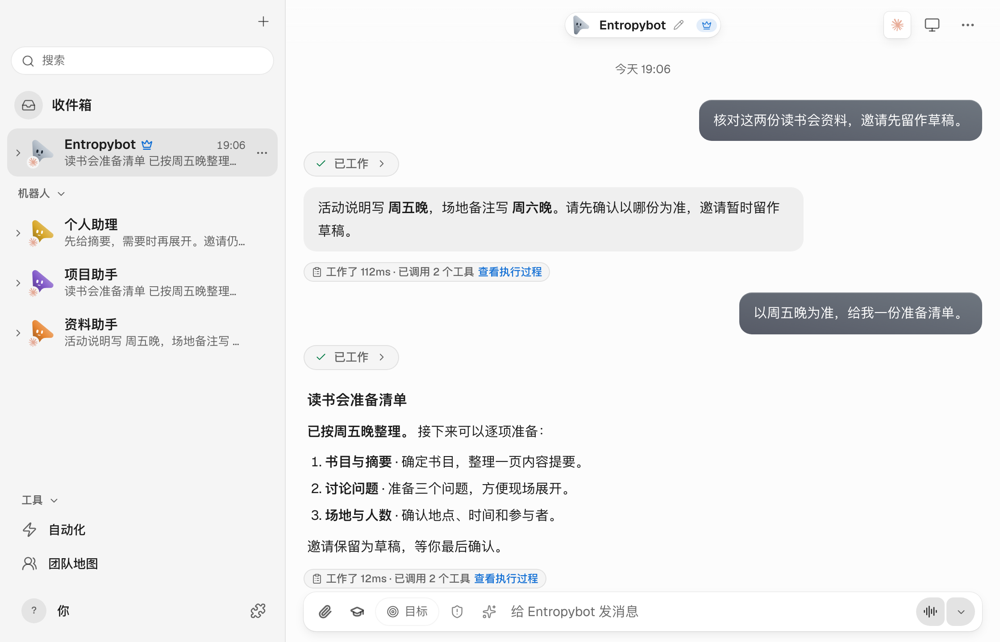

# Entropybot

把资料、记忆和任务放进同一个桌面工作区。本机优先的 macOS AI 助手，按你的选择连接模型与执行引擎。

[在线体验](https://bot.cloudentropy.ai/) · [下载 macOS 版](https://github.com/Ashersun1207/entropybot/releases/latest) · [English](README.en.md)

<a href="https://bot.cloudentropy.ai/">
<picture>
  <source media="(prefers-color-scheme: dark)" srcset="docs/images/readme-workspace-dark.png" />
  
</picture>
</a>

*截图来自当前开发版本的真实产品界面，使用合成数据与预设回复；公开下载版可能不同。点击图片可体验官网工作区，下载功能以 [Releases](https://github.com/Ashersun1207/entropybot/releases) 为准。*

## 用它做什么

| 场景 | 工作方式 |
| --- | --- |
| 整理资料 | 对照文档、归纳信息，把差异、依据和待确认事项放在一起。 |
| 推进任务 | 说明目标、时间和边界，让助手整理步骤与结果，需要你决定时再确认。 |
| 延续上下文 | 为不同职责建立助手，接着已有对话工作，查看和修订各自的记忆。 |
| 自选模型 | 按任务连接模型服务与执行引擎，管理自己的桌面工作区。 |

工具使用与任务执行取决于连接的模型、引擎及你授予的权限。

## 开始使用

1. 从 [Releases](https://github.com/Ashersun1207/entropybot/releases/latest) 下载 macOS Apple silicon 版本。
2. 安装后连接你选择的模型服务或执行引擎，配置相关凭证。
3. 新建或选择助手，交给它一个明确的任务；先从资料核对、摘要或准备清单开始。

也可以先打开[官网](https://bot.cloudentropy.ai/)，直接切换助手、输入和发送消息。在线体验支持中文 / EN，使用标签页内隔离的合成数据与预设回复，不连接真实模型、账号或个人记忆。

## 版本与数据

- 公开下载目前为 **0.2.3**；**0.2.6 仍是未公开发布的候选**。源码界面可能先于下载版本更新。
- 当前优先支持 **macOS Apple silicon**。公开安装包采用 ad-hoc 签名，未经 Apple 公证；安装前请阅读发布说明。
- 记忆与索引保存在本机。使用远程模型或云端 embedding 时，相关内容会发送到你配置的服务，并可能产生费用。
- 更新前退出应用并备份工作区与桌面配置。个人聊天、真实记忆和凭证不包含在公开仓库中。

[安装、备份与更新](docs/ENTROPYBOT_UPDATES.md) · [全部版本记录](https://github.com/Ashersun1207/entropybot/releases)

## 开发

需要 Node.js 24+ 和 pnpm 10.33.0：

```sh
pnpm install --frozen-lockfile
```

分别在两个终端启动服务与前端：

```sh
pnpm dev:server
```

```sh
pnpm dev
```

模型凭证仅在本地配置，不应提交。验证使用隔离 fixture 与合成数据，参见[验证说明](docs/verification/README.md)。应用 bundle ID 为 `ai.entropybot.desktop`，版本与更新渠道独立管理。

[官网构建与预览](site/README.md) · [官网体验约定](site/EXPERIENCE.md)

## 来源与许可

Entropybot 由 Ashersun1207 基于 [OpenMausBot](https://github.com/milind-soni/OpenMausBot) 独立开发，与上游维护者无隶属关系。保留原作者归属、[Apache-2.0 LICENSE](LICENSE) 和 [NOTICE](NOTICE)。

`enterprise/` 适用其[单独许可](enterprise/LICENSE)，不属于 Apache-2.0 授权范围。上游名称与美术资源的商标权归其权利人所有；本项目不授予相关商标权或企业生产使用许可。
